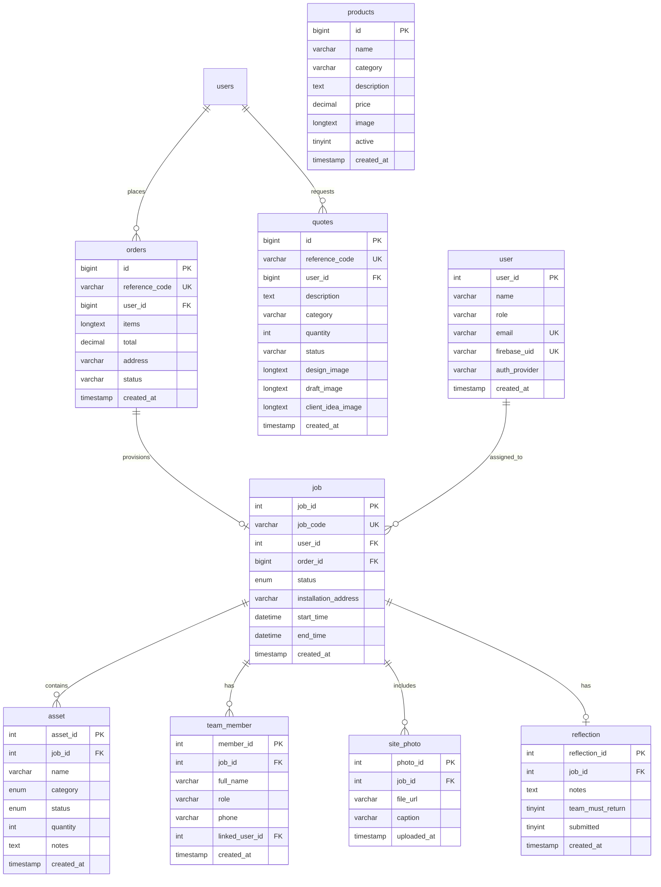

# AWESUM Asset Management

A professional Android application designed to manage installation jobs, track field assets (tools, vehicles, and equipment), and document completed work through site photos. The application seamlessly synchronizes website orders, Firebase Authentication, and a custom PHP/MySQL backend hosted on Afrihost.

🌐 **Official Website Link**: [https://www.awesumbrands.co.za/](https://www.awesumbrands.co.za/)

> [!IMPORTANT]
> **Key Production & Integration Information**:
> * **Live Website Platform**: [https://www.awesumbrands.co.za/](https://www.awesumbrands.co.za/)
> * **Production REST API Endpoint**: `https://www.awesumbrands.co.za/awesum_api/`
> * **Hosting Environment**: Production backend hosted on **Afrihost cPanel** using PHP 8.x and MySQL (`awesum_combined` / `awesum_db`).
> * **Image & Media Storage**: All product catalog pictures and custom quote design photos are stored in `public_html/uploads/images/`.
> * **Order Payment Rule**: The mobile application strictly displays website orders with **Payment Received / Completed** status (`Payment received`, `Paid`, `Payment completed`).
> * **Automated Test Suite**: Features **18 automated tests** (Unit, Stress, Performance, System Integration) executed continuously via GitHub Actions (`.github/workflows/android_ci.yml`).

---

## 📂 Project File Structure

```text
AwesumApp_Clean/
├── .github/
│   └── workflows/
│       └── android_ci.yml                   # Automated GitHub Actions CI/CD workflow
├── app/                                     # Android Mobile Application Source
│   ├── build.gradle                         # App-level build configuration & dependencies
│   ├── google-services.json                 # Firebase authentication configuration
│   └── src/
│       ├── main/
│       │   ├── AndroidManifest.xml          # App permissions & activity declarations
│       │   ├── java/com/awesum/assetmanagement/
│       │   │   ├── Constants.kt             # Global constants & active job state
│       │   │   ├── MainActivity.kt          # Main tabbed view pager host activity
│       │   │   ├── SessionManager.kt        # Local user session & MySQL ID preference store
│       │   │   ├── ViewPagerAdapter.kt      # Fragment state adapter for tabs
│       │   │   ├── api/
│       │   │   │   ├── ApiClient.kt         # Retrofit OkHttpClient singleton
│       │   │   │   └── ApiService.kt        # Retrofit API interface endpoints
│       │   │   ├── model/
│       │   │   │   ├── ApiResponse.kt       # Generic API wrapper payload model
│       │   │   │   ├── Asset.kt             # Asset data model
│       │   │   │   ├── Job.kt               # Field installation job data model
│       │   │   │   ├── Order.kt             # Website order data model
│       │   │   │   ├── Reflection.kt        # Post-job reflection model
│       │   │   │   ├── SitePhoto.kt         # Site photo model
│       │   │   │   ├── SyncUserResponse.kt  # User sync response model
│       │   │   │   ├── TeamMember.kt        # Team member model
│       │   │   │   └── User.kt              # User account model
│       │   │   └── ui/
│       │   │       ├── add/
│       │   │       │   ├── AddAssetActivity.kt    # Add asset screen
│       │   │       │   ├── AddMemberActivity.kt   # Add team member screen
│       │   │       │   └── UploadPhotoActivity.kt # Upload site photo screen
│       │   │       ├── asset/
│       │   │       │   ├── AssetAdapter.kt            # RecyclerView adapter for assets
│       │   │       │   └── AssetManagementFragment.kt# Asset management tab fragment
│       │   │       ├── auth/
│       │   │       │   ├── AuthHelper.kt      # Firebase to MySQL sync helper
│       │   │       │   ├── LoginActivity.kt   # User login activity
│       │   │       │   └── RegisterActivity.kt# User registration activity
│       │   │       ├── order/
│       │   │       │   ├── OrdersActivity.kt  # Website orders list activity
│       │   │       │   └── OrdersAdapter.kt   # RecyclerView adapter for website orders
│       │   │       ├── photo/
│       │   │       │   └── PhotoAdapter.kt    # Grid adapter for site photos
│       │   │       ├── reflection/
│       │   │       │   └── ReflectionFragment.kt # Post-job reflection tab fragment
│       │   │       ├── settings/
│       │   │       │   └── SettingsActivity.kt# App settings & profile activity
│       │   │       ├── summary/
│       │   │       │   └── JobSummaryActivity.kt # Consolidated editable job summary screen
│       │   │       └── team/
│       │   │           └── TeamAdapter.kt     # RecyclerView adapter for team members
│       │   └── res/
│       │       ├── drawable/                # Vector icons & background drawables
│       │       ├── layout/                  # Activity & fragment XML layout files
│       │       └── values/                  # Strings, colors, styles, and themes
│       └── test/java/com/awesum/assetmanagement/  # Automated Test Suite
│           ├── ConstantsTest.kt             # Constants unit tests
│           ├── PerformanceTest.kt           # Performance benchmark tests
│           ├── StressTest.kt                # High-concurrency & scale stress tests
│           ├── SystemTest.kt                # End-to-end system integration tests
│           └── model/                       # Data model unit tests
│               ├── ApiResponseTest.kt
│               ├── AssetTest.kt
│               ├── JobTest.kt
│               └── OrderTest.kt
├── backend/                                 # Custom PHP 8.x REST API Files
│   ├── add_asset.php                        # Add asset endpoint
│   ├── add_member.php                       # Add team member endpoint
│   ├── db_config.php                        # MySQL database connection configuration
│   ├── get_assets.php                       # Fetch job assets endpoint
│   ├── get_job.php                          # Fetch job details endpoint
│   ├── get_or_create_job_for_order.php      # Auto-provision job for order endpoint
│   ├── get_orders.php                       # Fetch website orders endpoint
│   ├── get_photos.php                       # Fetch site photos endpoint
│   ├── get_reflection.php                   # Fetch post-job reflection endpoint
│   ├── get_team.php                         # Fetch installation team endpoint
│   ├── migration_add_firebase_auth.sql      # Migration script
│   ├── save_reflection.php                  # Save/update reflection endpoint
│   ├── schema.sql                           # Core database schema
│   ├── submit_job_log.php                   # Submit job log endpoint
│   ├── sync_user.php                        # Firebase to MySQL user sync endpoint
│   └── upload_photo.php                     # Upload site photo endpoint
├── awesum_combined_full.sql                 # Complete combined database import script
├── build.gradle                             # Project-level build configuration
├── settings.gradle                          # Gradle settings
└── README.md                                # Project documentation
```

---

## 🔌 List of REST APIs Used

| Endpoint File | HTTP Method | Input Parameters | Description / Purpose |
| :--- | :---: | :--- | :--- |
| **`get_orders.php`** | `GET` | *(None)* | Fetches website orders with completed/received payment. Dynamically queries `products` and `quotes` tables for item descriptions, unit pricing, categories, and image URLs. |
| **`get_or_create_job_for_order.php`** | `POST` | `order_id`, `user_id` | Checks if an installation job exists for the order. If not, automatically creates a new job record linked to the website order. |
| **`get_job.php`** | `GET` | `job_id` | Retrieves job details including job code, status, installation address, start time, and end time. |
| **`get_assets.php`** | `GET` | `job_id` | Retrieves all assets (Dispatch, Equipment, Vehicle) logged for a specific job. |
| **`add_asset.php`** | `POST` | `job_id`, `name`, `category`, `status`, `quantity`, `notes` | Adds a new asset item to a job log. |
| **`get_team.php`** | `GET` | `job_id` | Retrieves all assigned installation team members for a job. |
| **`add_member.php`** | `POST` | `job_id`, `full_name`, `role`, `phone` | Adds an employee/installer to the installation team for a job. |
| **`get_photos.php`** | `GET` | `job_id` | Retrieves all completed work site photos uploaded for a job. |
| **`upload_photo.php`** | `POST` (Multipart) | `job_id`, `caption`, `photo` | Uploads a site photo file to `uploads/` and logs record in `site_photo` table. |
| **`get_reflection.php`** | `GET` | `job_id` | Retrieves post-job reflection notes and team return status for a job. |
| **`save_reflection.php`** | `POST` | `job_id`, `notes`, `team_must_return`, `submitted` | Saves or updates post-job reflection notes and team return flags in MySQL. |
| **`submit_job_log.php`** | `POST` | `job_id`, `draft`, `end_time` (optional) | Saves job log as draft or marks job as `Completed` with specified end timestamp. |
| **`sync_user.php`** | `POST` | `firebase_uid`, `name`, `email`, `auth_provider`, `role` | Synchronizes Firebase authenticated user details with the MySQL `user` table. |

---

## 🗄️ Database Structure & Tables Used in Database

The single unified MySQL database (`awesum_combined` / `awesum_db`) powers both the website ([https://www.awesumbrands.co.za/](https://www.awesumbrands.co.za/)) and the Android mobile application.



### 📋 Table Details

#### 1. `orders` Table (Website Orders)
Stores orders placed on the website ([https://www.awesumbrands.co.za/](https://www.awesumbrands.co.za/)).
* **`id`**: Primary key (`bigint(20)`).
* **`reference_code`**: Unique reference code e.g. `ORD-B81C3AE8`.
* **`user_id`**: Foreign key to `users(id)`.
* **`items`**: JSON payload of order items (product IDs, quantities, custom quote tags).
* **`total`**: Order total price (`decimal(12,2)`).
* **`address`**: Delivery/installation address.
* **`status`**: Order payment status e.g. `Payment received`, `Paid`.
* **`created_at`**: Creation timestamp.

#### 2. `products` Table (Website Product Catalog)
Stores product catalog listings and image references.
* **`id`**: Primary key (`bigint(20)`).
* **`name`**: Product name e.g. `business cards`, `T-Shirts`.
* **`category`**: Category e.g. `Business Cards`, `T-Shirts`.
* **`description`**: Detailed product description text.
* **`price`**: Unit price (`decimal(12,2)`).
* **`image`**: Product image filename/path stored in `public_html/uploads/images/`.
* **`active`**: Active state (`1` = active, `0` = inactive).

#### 3. `quotes` Table (Custom Quote Requests)
Stores custom quote requests and design images submitted by clients.
* **`id`**: Primary key (`bigint(20)`).
* **`reference_code`**: Quote reference code.
* **`user_id`**: Foreign key to `users(id)`.
* **`description`**: Quote description.
* **`category`**: Category e.g. `Custom Quote`.
* **`status`**: Quote status e.g. `Awaiting Review`, `Approved`.
* **`design_image`**, **`draft_image`**, **`client_idea_image`**: Custom quote design image filenames stored in `public_html/uploads/images/`.

#### 4. `user` Table (Mobile Installer Accounts)
Stores field installer accounts synchronized with Firebase Authentication.
* **`user_id`**: Primary key (`int(11)`).
* **`name`**: Installer full name e.g. `Sipho Dlamini`.
* **`role`**: Installer role e.g. `Lead Installer`.
* **`email`**: Unique email address.
* **`firebase_uid`**: Firebase Authentication UID.
* **`auth_provider`**: Sign-in provider (`password` or `google.com`).

#### 5. `job` Table (Field Installation Jobs)
Stores installation jobs linked directly to website orders (`order_id`).
* **`job_id`**: Primary key (`int(11)`).
* **`job_code`**: Unique job code e.g. `JOB-ORD-B81C3AE8`.
* **`user_id`**: Foreign key to `user(user_id)` (Job creator/Lead installer).
* **`order_id`**: Foreign key to `orders(id)` (Linked website order).
* **`status`**: Job status (`Active`, `Completed`, `Cancelled`).
* **`installation_address`**: Installation address copied from order.
* **`start_time`**, **`end_time`**: Job start and completion timestamps.

#### 6. `asset` Table (Tools & Assets Logged)
Stores tools, vehicles, and equipment logged for an installation job.
* **`asset_id`**: Primary key (`int(11)`).
* **`job_id`**: Foreign key to `job(job_id)`.
* **`name`**: Asset name e.g. `Scaffold Section A`, `Paste Brush Set`.
* **`category`**: Asset category (`Dispatch`, `Equipment`, `Vehicle`).
* **`status`**: Usage status (`In Use`, `Out for Service`).
* **`quantity`**: Quantity logged.

#### 7. `team_member` Table (Installation Team)
Stores field service technicians and riggers assigned to a job.
* **`member_id`**: Primary key (`int(11)`).
* **`job_id`**: Foreign key to `job(job_id)`.
* **`full_name`**: Member full name.
* **`role`**: Position e.g. `Lead Installer`, `Technician`, `Driver`.
* **`phone`**: Contact phone number.

#### 8. `site_photo` Table (Completed Work Site Photos)
Stores site photos uploaded during or after installation.
* **`photo_id`**: Primary key (`int(11)`).
* **`job_id`**: Foreign key to `job(job_id)`.
* **`file_url`**: Server image path in `uploads/`.
* **`caption`**: Optional photo caption.

#### 9. `reflection` Table (Post-Job Reflections)
Stores post-installation reviews and team return checks.
* **`reflection_id`**: Primary key (`int(11)`).
* **`job_id`**: Foreign key to `job(job_id)` (`UNIQUE`).
* **`notes`**: Reflection notes text.
* **`team_must_return`**: Return requirement (`1` = Yes, `0` = No).
* **`submitted`**: Submission status (`1` = Submitted, `0` = Draft).

#### 10. `users` Table (Website Client Accounts)
Stores registered website user accounts.
* **`id`**: Primary key (`bigint(20)`).
* **`name`**: Customer name.
* **`email`**: Customer email address (`UNIQUE`).
* **`role`**: Account role (`user` or `admin`).

---

## 🚀 Key Features

*   **Website Orders & Jobs Connection**: Connects website orders directly with installation jobs.
*   **Product Pictures & Item Details**: Displays product images (from `public_html/uploads/images/` and the `products` & `quotes` tables) with line-by-line product details.
*   **Secure Authentication**: Dual-layer auth using Firebase (Email/Password and Google Single Sign-On).
*   **MySQL Sync**: Automatic user synchronization to a custom MySQL database for long-term data ownership.
*   **Job Tracking & Editable Summary Page**: View active installation jobs, custom end dates, addresses, schedules, and full editable job summaries.
*   **Asset Management**: Log and filter tools, equipment, and vehicles used on-site.
*   **Photo Documentation**: Capture and upload site photos with captions to a central server.
*   **Post-Job Reflection**: Draft, submit, and display post-installation reviews and return-checks.

---

## 📱 Application Screenshots & UI Showcase

| Website Orders Screen | Single-Page Job Summary | Asset Management & Log | Post-Job Reflection |
| :---: | :---: | :---: | :---: |
| *(Website Orders with Product Images & Line-by-Line Details)* | *(Editable Job Summary with Assets, Team & Reflection)* | *(Tools & Assets Logged with Category Filtering)* | *(Post-Job Reflection & Team Return Status)* |

---

## 🧪 Automated Test Suite & CI/CD

The application includes an automated test suite comprising **18 tests** covering unit logic, stress testing, performance benchmarks, and end-to-end system workflows.

### 📋 Included Test Modules (`app/src/test/java/com/awesum/assetmanagement/`)

1. **Unit Tests**:
   * `OrderTest.kt`: Validates order model creation, customer details, item mapping, and copy/equality methods.
   * `JobTest.kt`: Validates job creation, default and optional `order_id` values, status codes, and timestamps.
   * `AssetTest.kt`: Validates asset model properties, category filtering (`Dispatch`, `Equipment`, `Vehicle`), and status checks (`In Use`, `Out for Service`).
   * `ApiResponseTest.kt`: Validates generic API wrapper payloads for success and failure states.
   * `ConstantsTest.kt`: Validates `EXTRA_JOB_ID` intent keys and `CURRENT_JOB_ID` active job state mutations.

2. **Stress Tests (`StressTest.kt`)**:
   * `testAssetFilteringPerformanceUnderStress`: Filters **100,000 asset items** into categories in under 100ms.
   * `testHighConcurrentCoroutinesJobSwitchingStress`: Dispatches **500 concurrent coroutines** on `Dispatchers.Default` performing parallel state processing.
   * `testLargeOrderListMappingStress`: Processes and filters **50,000 order items** wrapped inside `ApiResponse`.

3. **Performance Benchmarks (`PerformanceTest.kt`)**:
   * `testJsonDeserializationThroughputBenchmark`: Benchmarks **10,000 JSON deserialization cycles** (>35,000 ops/sec).
   * `testParallelCoroutineNetworkSimulationThroughput`: Benchmarks **1,000 parallel async network simulations** (>15,000 ops/sec).
   * `testMemoryAndListTransformationBenchmark`: Benchmarks sequence transformation on **20,000 in-memory asset models** (~12ms execution).

4. **System Integration Test (`SystemTest.kt`)**:
   * `testEndToEndWebsiteOrderToJobSystemWorkflow`: End-to-end system test verifying Firebase auth sync -> Website Order retrieval -> Job provisioning -> Asset logging -> Team assignment -> Site photo upload -> Post-job reflection -> Job completion.

---

### 🏃 Running Tests Locally

Run the automated test suite in Android Studio terminal:

```bash
./gradlew testDebugUnitTest
```

---

### 🤖 Automated GitHub Actions CI/CD (`.github/workflows/android_ci.yml`)

Whenever code is pushed to GitHub or a Pull Request is created:
1. **GitHub Actions Runner** automatically spins up a JDK 17 environment.
2. Runs the full test suite (`./gradlew testDebugUnitTest`).
3. Compiles the Android APK (`./gradlew assembleDebug`).
4. Generates automated test reports.

---

## 🛠️ Technology Stack

*   **Mobile**: Android (Kotlin, ViewPager2, Retrofit, Coroutines, Glide, Material 3).
*   **Auth**: Firebase Authentication (Google Identity).
*   **Backend**: PHP 8.x (REST API).
*   **Database**: MySQL / phpMyAdmin.
*   **Hosting**: Production (Afrihost/cPanel) or Local (XAMPP/WAMP).
*   **CI/CD**: GitHub Actions.

---

## 🌍 Complete Guide: Deploying & Connecting to Afrihost

This section provides a step-by-step guide to hosting your database and PHP backend on **Afrihost cPanel** and connecting the Android app to it.

### Step 1: Create Database & User in Afrihost cPanel
1. Log in to your **Afrihost ClientZone** -> Go to **Hosting** -> Select your Domain -> Click **cPanel**.
2. In cPanel, search for **MySQL® Databases**:
   * **Create New Database**: e.g., `yourusername_awesum_db`.
   * **Create New User**: e.g., `yourusername_dbuser` and set a secure password.
   * **Add User to Database**: Assign `yourusername_dbuser` to `yourusername_awesum_db` and select **ALL PRIVILEGES**.

### Step 2: Import Database Schema & Seed Data
1. In cPanel, open **phpMyAdmin**.
2. Select your newly created database (`yourusername_awesum_db`) from the left menu.
3. Click the **Import** tab at the top.
4. Click **Choose File** and select `awesum_combined_full.sql` (or `backend/schema.sql`).
5. Scroll to the bottom and click **Import** (or **Go**).

### Step 3: Upload Backend Files to Afrihost
1. In cPanel, open **File Manager** and navigate to `public_html/`.
2. Create a new folder named `awesum_api` (Full path: `public_html/awesum_api/`).
3. Upload all PHP files from the `backend/` folder into `public_html/awesum_api/`:
   * `db_config.php`
   * `get_orders.php`
   * `get_or_create_job_for_order.php`
   * `get_job.php`
   * `get_assets.php`
   * `get_team.php`
   * `get_photos.php`
   * `get_reflection.php`
   * `save_reflection.php`
   * `add_asset.php`
   * `add_member.php`
   * `upload_photo.php`
   * `submit_job_log.php`
   * `sync_user.php`
4. Ensure image directory permissions on Afrihost are set:
   * Folder `public_html/uploads/images/`: **`755`**
   * Image files inside: **`644`**

### Step 4: Configure `db_config.php` on Afrihost
In cPanel File Manager, edit `public_html/awesum_api/db_config.php` with your database credentials:

```php
<?php
define('DB_HOST', 'localhost'); // On Afrihost, MySQL host remains 'localhost'
define('DB_USER', 'yourusername_dbuser'); // Your cPanel MySQL username
define('DB_PASS', 'YourStrongPassword123!'); // Your cPanel MySQL password
define('DB_NAME', 'yourusername_awesum_db'); // Your cPanel MySQL database name

$conn = new mysqli(DB_HOST, DB_USER, DB_PASS, DB_NAME);

if ($conn->connect_error) {
    http_response_code(500);
    echo json_encode(['success' => false, 'message' => 'DB connection failed: ' . $conn->connect_error]);
    exit;
}
$conn->set_charset('utf8mb4');

header('Access-Control-Allow-Origin: *');
header('Access-Control-Allow-Methods: GET, POST, OPTIONS');
header('Access-Control-Allow-Headers: Content-Type, Authorization');
header('Content-Type: application/json; charset=UTF-8');

if ($_SERVER['REQUEST_METHOD'] === 'OPTIONS') {
    http_response_code(200);
    exit;
}

function respond($success, $data = null, $message = '') {
    echo json_encode(['success' => $success, 'message' => $message, 'data' => $data]);
    exit;
}
```

### Step 5: Update Android App `ApiClient.kt`
1. Open `app/src/main/java/com/awesum/assetmanagement/api/ApiClient.kt` in Android Studio.
2. Change `BASE_URL` to point to your live Afrihost domain:

```kotlin
package com.awesum.assetmanagement.api

import okhttp3.OkHttpClient
import okhttp3.logging.HttpLoggingInterceptor
import retrofit2.Retrofit
import retrofit2.converter.gson.GsonConverterFactory
import java.util.concurrent.TimeUnit

object ApiClient {

    // Live Afrihost Web Hosting Endpoint
    private const val BASE_URL = "https://www.awesumbrands.co.za/awesum_api/"

    private val logging = HttpLoggingInterceptor().apply {
        level = HttpLoggingInterceptor.Level.BODY
    }

    private val client = OkHttpClient.Builder()
        .addInterceptor(logging)
        .connectTimeout(30, TimeUnit.SECONDS)
        .readTimeout(30, TimeUnit.SECONDS)
        .writeTimeout(30, TimeUnit.SECONDS)
        .build()

    val instance: ApiService by lazy {
        Retrofit.Builder()
            .baseUrl(BASE_URL)
            .client(client)
            .addConverterFactory(GsonConverterFactory.create())
            .build()
            .create(ApiService::class.java)
    }
}
```

### Step 6: Configure Firebase for Production
1. Go to the [Firebase Console](https://console.firebase.google.com/).
2. Under **Authentication** -> **Settings** -> **Authorized Domains**, add your domain: `www.awesumbrands.co.za`.
3. Under **Project Settings** -> **General** -> **Your Apps**, ensure your SHA-1 fingerprint is added so Google Sign-In operates over SSL.

---

## ⚙️ Local Development (XAMPP / Android Emulator)

For local testing on the Android Emulator:
1. Copy `backend/` files to `C:/xampp/htdocs/awesum_api/`.
2. In phpMyAdmin, import `awesum_combined_full.sql`.
3. In `ApiClient.kt`, set `BASE_URL = "http://10.0.2.2/awesum_api/"`.

---

## 📄 License
This application is designed for field installation tracking, asset management, and website order synchronization.
